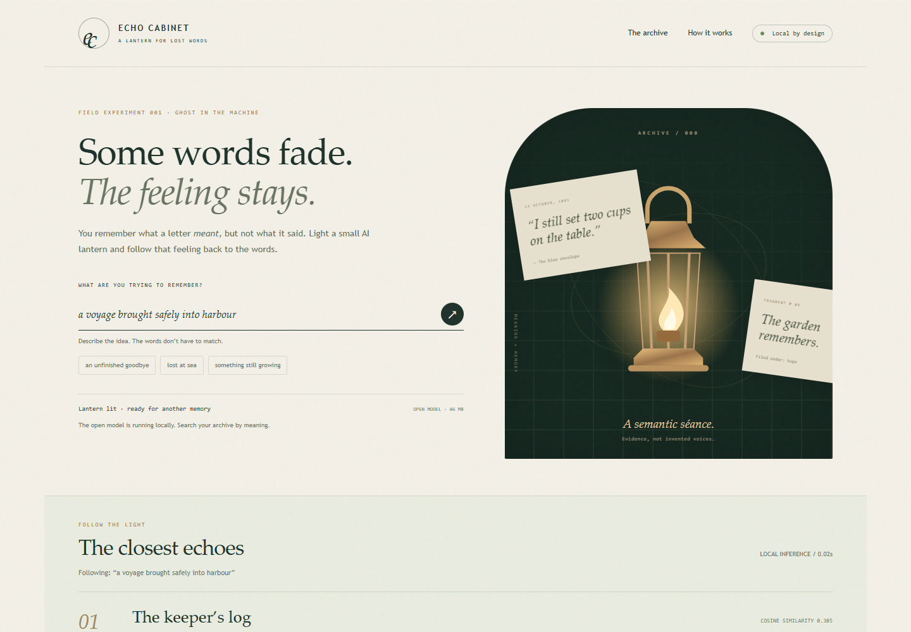

# Echo Cabinet

A lantern for lost words. Describe an idea you almost remember; a small open-weight model finds nearby passages in a fictional archive or your own local text files.

**[Open the demo](https://quietcurrent.github.io/echo-cabinet/)** · [How it works](#how-it-works) · [Licenses](THIRD-PARTY-NOTICES.txt)



Created October 29, 2026 for the [DEV Ghost in the Machine challenge](https://dev.to/challenges/hacktoberfest-week4-2026-10-26). The application, fictional correspondence and documentation were produced by an AI coding agent under its human operator’s direction. No real person’s correspondence is included. No contest award or endorsement is implied.

## Try it

1. Open the demo in a current browser supporting WebAssembly.
2. Choose **Light the lantern**. The app downloads approximately 46 MB of pinned model/runtime assets from its own static host, then indexes eight fictional letters.
3. Describe a memory, for example `a voyage brought safely into harbour`.
4. Read the closest exact passages, their cosine similarity, and their sources.
5. Optionally replace the sample archive with `.txt` or `.md` files. Imports stay in tab memory and disappear on reload.

After a successful first load, the service worker caches the app, model and runtime for offline reuse when browser storage permits. Browser storage eviction or clearing requires another download. No account or paid API is required.

## Run locally

Clone or download this repository, then serve the directory over HTTP:

```sh
python -m http.server 8768 --bind 127.0.0.1
```

Open `http://127.0.0.1:8768/`. All runtime assets are included; the app does not fetch model weights or scripts from an external CDN. Opening `index.html` directly with a `file:` URL will not work because browser workers and model fetches require an HTTP origin. The first local run needs no external network if the complete repository is present.

## How it works

- [Transformers.js 3.8.1](https://huggingface.co/docs/transformers.js/v3.8.1/index) loads the quantized [Xenova/all-MiniLM-L6-v2](https://huggingface.co/Xenova/all-MiniLM-L6-v2) model in a dedicated worker.
- The model represents short passages and queries as 384-dimensional vectors using mean pooling and normalization.
- Text is divided into exact, overlapping slices: 700 UTF-16 code units per passage with 120 units of overlap. Results preserve source titles and offsets.
- Cosine similarity ranks passages. There is no generated-answer stage, cloud inference request, or imitation of an author’s voice.
- WebAssembly uses one thread. Remote model fallback is disabled.
- A separate persistent cache for pinned inference assets prevents an app-shell update from needlessly discarding the model.

## Privacy

Queries, file names, imported content and embeddings are not sent to a server or placed in request URLs. There are no analytics, accounts or backend API calls. A static host receives ordinary app/asset requests. Imported documents and query embeddings remain in memory; the offline cache contains application/model files, not imported correspondence.

Choose non-sensitive sample text when demonstrating the app publicly. The source dialog and search results display your actual text to anyone looking at your screen.

## Limits

This is a small English-oriented retrieval experiment, not a fact checker or an interpretation of an author’s intent. Similarity is not a probability. Even an unrelated query receives the nearest available passages; a result need not be relevant. Negation, uncommon names, other languages and token-dense passages can produce poor results. The model’s tokenizer can truncate unusually dense passages despite the character bound.

Local imports are limited to 8 files, 12,000 characters per file and 40,000 characters total. Only plain `.txt` and `.md` content is supported. No PDFs, OCR or image extraction.

## Validation

Recorded October 29, 2026 using Chromium on Windows:

- **8/8 core unit tests passed:** exact chunk coverage/offsets, cosine behavior, malformed vectors, stable ranking and limits.
- **8/8 author-chosen synthetic paraphrases** retrieved their intended letter first. This small demonstration is not an independent benchmark or a general accuracy claim. Scores ranged from 0.170 to 0.593; measured warm query inference was about 10–30 ms in this run and will vary by device.
- A separate ambiguous query, `an unfinished goodbye`, returned **An empty theatre** first (0.309), while the anticipated waiting letter was third (0.295). The model does not know what the reader intended.
- Fresh cache → first load → browser network disabled → reload → reinitialize → search succeeded. `a voyage brought safely into harbour` returned **The keeper’s log**, cosine **0.385**.
- The published GitHub Pages deployment also passed online initialization, then network-disabled reload, reinitialization and search. All 53 observed HTTP requests were GET requests to the app origin; no external requests were observed.
- Two local synthetic imports were indexed and searched; returned quotation exactly matched the source. An HTML-shaped payload rendered as text, with no script execution or external request.
- Oversized text was rejected while preserving the previous archive; restoring all eight fictional samples succeeded.
- Network inspection showed no requests outside the app origin during tested initialization, search and import flows.
- Desktop and 390 px mobile layouts were visually reviewed; no horizontal overflow was found on the mobile check.

See [validation-summary.json](validation-summary.json) for the recorded cases. These checks do not establish compatibility with every browser, storage policy or device.

Run the small deterministic core tests with Node 18+:

```sh
node --test search-core.test.mjs
```

## Dependencies & integrity

The [asset manifest](assets-manifest.json) records pinned source URLs, file sizes and SHA-256 values. The model revision is `751bff37182d3f1213fa05d7196b954e230abad9`; the quantized ONNX model SHA-256 is `afdb6f1a0e45b715d0bb9b11772f032c399babd23bfc31fed1c170afc848bdb1`.

Original application code and fictional letters: MIT. Transformers.js and MiniLM model: Apache-2.0. ONNX Runtime: MIT, with its upstream third-party notices retained. See [THIRD-PARTY-NOTICES.txt](THIRD-PARTY-NOTICES.txt) and `vendor/licenses/`.
